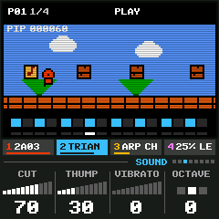
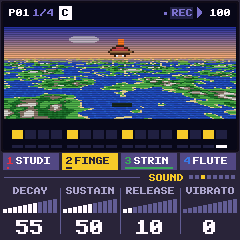
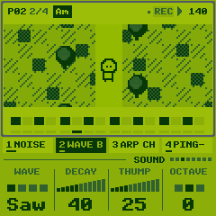
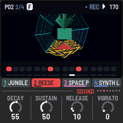

# CRT-4 for the M-VAVE FM-1

[](https://github.com/devrvega/CRT-4/actions/workflows/build.yml)
[](https://github.com/devrvega/CRT-4/releases/latest)
[](LICENSE)

CRT-4 turns the M-VAVE FM-1 into a four-track groovebox that plays the sound chips of nine game consoles and
home computers. Choose a console and you play it: its drums on the first track and any of its sixteen
sounds on the other three, made the way that console made them, with its own echo or reverb. The whole
screen dresses as that console, with a scene of its time that moves with the music. Each console keeps its
own song.



| | |
|---|---|
| **[Try it in the browser](https://devrvega.github.io/CRT-4/emu/)** | The same code the FM-1 runs, with sound. No FM-1 needed. |
| **[Install it](https://devrvega.github.io/CRT-4/install/)** | From Chrome or Edge, with the FM-1 on USB. Nothing to install on the computer. |
| **[Read the manual](docs/MANUAL.md)** | Getting started in ten steps, then every control, console, sound and page. |
| **[Download](https://github.com/devrvega/CRT-4/releases/latest)** | The firmware file (`crt4-X.Y.Z.fwsc`) of every release, and its source. |

## The consoles

| Console | Its chip, as CRT-4 makes it | Some of its sounds |
|---|---|---|
| **Atari 2600** | The TIA: dividers and polynomial counters, notes only near the scale | Buzz, Pure, Drone, Siren, Laser, Engine |
| **Commodore 64** | The SID 6581 (or 8580): combined waves, ring, sync, its filter; 4-bit digis | PWM lead, Filter bass, Ring bells, Sync sweep |
| **NES** | The 2A03 and the Famicom's VRC6, FDS, N163 and 5B | Triangle, DMC bass, VRC6 saw, FDS wave, Echo lead |
| **PC Engine** | The HuC6280's 5-bit wavetables, its LFO, DDA; the CD-ROM's ADPCM | Wave bass, Shmup lead, CD strings, CD guitar |
| **Genesis** | The YM2612 (four operators, its gritty DAC) and the SN76489 | Slap, House bass, E.Piano, Scream, Orch hit |
| **Game Boy** | Two pulses, the 4-bit wave channel, the noise; left, right or both | Wave bass, Wobble, Ping-pong, Speech |
| **SNES** | The S-DSP: BRR at 32 kHz, Gaussian interpolation, echo through its FIR | Strings, Choir, Slap bass, Flute, Orch hit |
| **PlayStation** | The SPU: ADPCM at 44.1 kHz, its reverb's presets; a sliced breakbeat | Reese, Space pad, Gothic organ, Rhodes, Sitar |
| **N64** | ADPCM mixed at 22 kHz, its rooms, echo, chorus, flange | Tuba, Marimba, Ocarina, Accordion, Steel drum |

Each has two drum kits and sixteen sounds (four basses, four keys, four leads, four of its own), listed in
the [manual](docs/MANUAL.md#13-the-nine-consoles-one-by-one). On the 2600, the C64, the NES and the Game Boy a
track plays a note at a time and a chord is an arpeggio, a note a frame, as their music was; the others play
real chords. None of the samples is a recording: a program in the source makes each one, by modelling the
instrument, and stores it in the console's own format.

  

## In short

| | |
|---|---|
| GLO held + ALGORITHM | Another console (they stand on a shelf; let go of GLO and it powers on) |
| ALGORITHM · PRESETS | The track (1 drums, 2–4 the others) · its sound or kit |
| Keys | Drums: black keys the parts, white keys their steps · the others: a keyboard |
| PLAY · REC | Play / stop · write (live while playing, step by step stopped) |
| HOME · SEQ · LFO · ENV · ARP · SEL · FX · GLO | The pages: Patterns, Steps, Sound, Track, Chords, Mixer, FX, Setup |
| HOME / ARP / FX held | The white keys are patterns, chords, effects (pressed in order: a chain) |
| A step held + knobs | Its note, length, locks; OCT− a slide, OCT+ a ratchet |
| ENV · EDIT held + a key | An accent · cleared |
| SAVE | Saves (and by itself, stopped); held + a pattern: a copy; held on Setup: the console's demo back |

Hold any button for a second and a card says what it does.

## Installing, and going back

- **From the browser:** the [web installer](https://devrvega.github.io/CRT-4/install/) (Chrome or Edge, a USB
  data cable).
- **From the command line:** download `crt4-X.Y.Z.fwsc` from the
  [latest release](https://github.com/devrvega/CRT-4/releases/latest), then
  `pip3 install mido python-rtmidi` and `python3 tools/fm1_install.py crt4-X.Y.Z.fwsc`.
- **Going back:** the installer's "Back to the stock firmware" puts M-VAVE's firmware back, as does M-VAVE's
  own updater, M-UPGRADE. Any other FM-1 firmware installs over CRT-4 as it would over the stock one.
- **Your saved work, and other firmwares':** CRT-4 keeps its settings where several other FM-1 firmwares keep
  theirs, and its nine songs in the FM-1's main store, where some firmwares keep their samples. A console's
  first save there replaces what another firmware had saved in that place.

Installing other firmware is at your own risk, though it's hard to get stuck: an FM-1 that fails to start
twice comes up in a safe mode the installer can reach, and the manual's
[Troubleshooting](docs/MANUAL.md#16-troubleshooting) covers the rest.

## Status

CRT-4 is young (0.x). It builds, it fits (the firmware takes about 515 of the FM-1's 568 KB, the samples
included), and it has been measured on an FM-1. Each console's demo uses 3–22% of the FM-1's time for its
sound, and no render runs late. The heaviest test is three tracks of four-note chords on a console's heaviest
sounds, with every drum on every step. At its worst moment it takes 77% of a render's time on the Genesis and
at most two thirds on the others. The screen draws about 60 frames a second, and 53–57 on the PlayStation and
the N64 while their demos play. How it all sounds is where feedback helps most.

## Ideas and problems

- **Something you'd like:** a [feature request](https://github.com/devrvega/CRT-4/issues/new?template=feature_request.yml).
- **Something wrong:** a [bug report](https://github.com/devrvega/CRT-4/issues/new?template=bug_report.yml)
  (the version is at the bottom left of the Setup page).

## Make it your own

Fork it, change it, release your own: [CONTRIBUTING.md](CONTRIBUTING.md) says where things are, how to give
your version its own name and identity, and how to send changes back. Every push is built and tested on
GitHub; a tag `vX.Y.Z` makes a release, and the site (emulator, installer, manual) follows it.

```
tests/run_tests.sh                               # the tests, the app in a simulator
./build.sh                                       # build/crt4.fwsc (see BUILDING.md)
python3 tools/fm1_install.py build/crt4.fwsc     # install it over USB
```

## Credits

CRT-4 is built on LCD-4 and IND-1, themselves built on [AMB-1](https://github.com/charlesvestal/fm1-amb) by
Charles Vestal: the engine's frame, screen, simulator and emulator. The platform (hardware layer, USB, update
loader, storage, installer) is [Felucca](https://github.com/hugelton/Felucca)'s by Leo Kuroshita (Hügelton
Instruments), by way of [X0X](https://github.com/charlesvestal/fm1-x0x), FoMni, AMB-1, IND-1 and LCD-4. The
idea of running FM-1 firmware in the browser comes from [Groove OS](https://www.groove-os.com/).
GPL-3.0-only; see [LICENSING.md](LICENSING.md).

M-VAVE and FM-1 are trademarks of their owners, as are the names of the consoles, computers and chips. CRT-4
is not affiliated with M-VAVE, Atari, Commodore, Nintendo, NEC, Hudson, Sega, Sony, Yamaha, the chips'
makers, Charles Vestal or Hügelton Instruments; its sounds, samples, songs, scenes and characters are its
own.
