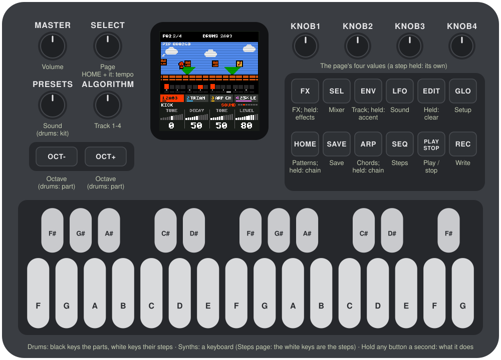
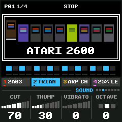
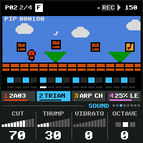

# CRT-4

CRT-4 turns the M-VAVE FM-1 into a four-track groovebox that plays the sound chips of nine game consoles
and home computers: the Atari 2600, the Commodore 64, the NES, the PC Engine, the Genesis, the Game Boy, the
SNES, the PlayStation and the N64. Pick a console and you play it: its drums on the first track, any of its
sixteen sounds on the other three, made the way that console made them, with its own echo or reverb. The
whole screen dresses as the console, with a scene of its time that moves with the music. Each console keeps
a song of its own: 16-step patterns, chains, chords and punch-in effects, the way LCD-4 works.



---

## Contents

1. Install
2. Getting started
3. Controls
4. The consoles
5. The screen
6. The tracks
7. The drums
8. Writing
9. Patterns and chains
10. Chords
11. Effects
12. The pages
13. The nine consoles, one by one
14. MIDI
15. Saving
16. Troubleshooting
17. Credits

---

## 1. Install

**Try it first:** [the browser emulator](https://devrvega.github.io/CRT-4/emu/) runs the same code with
sound, played with the mouse, a touch screen or the keyboard.

**Install from the browser:** open [the web installer](https://devrvega.github.io/CRT-4/install/) in
Chrome or Edge, connect the FM-1 with a USB data cable and press Install. Don't unplug it while it's
writing; when it finishes, the FM-1 restarts into CRT-4.

**Install from the command line:** download `crt4-X.Y.Z.fwsc` from the
[latest release](https://github.com/devrvega/CRT-4/releases/latest), install Python 3 with
`pip3 install mido python-rtmidi`, and from the CRT-4 source run:

```
python3 tools/fm1_install.py crt4-X.Y.Z.fwsc
```

**Which version:** the Setup page (GLO) shows it at the bottom left, and the start screen under the name.

**Go back:** "Back to the stock firmware", at the bottom of the installer page, puts M-VAVE's firmware
back (download the FM-1 V15 file from the link there, choose it, press the button). M-VAVE's own
updater, M-UPGRADE, works too.

> Installing other firmware is at your own risk. If the FM-1 ever won't start, see
> [Recovering an FM-1 that won't start](#recovering-an-fm-1-that-won-t-start).

**Coming from another firmware:** CRT-4 keeps its settings where IND-1, LCD-4, AMB-1 and others keep
theirs, under its own name, and its nine songs in the FM-1's main store (where some firmwares keep
samples). None of them reads the others': CRT-4 starts on the NES with its demo song, and each console's
first save replaces what another firmware had saved in that place.

---

## 2. Getting started

1. Switch the FM-1 on and turn **MASTER** up. CRT-4 powers on the NES: its start screen, then its demo
   song, stopped.
2. Press **PLAY**. Four tracks play: the 2A03's drums, the triangle's bass, pulse arpeggios and a pulse
   lead with an echo, over a chain of patterns and chords.
3. **Hold GLO and turn ALGORITHM.** The consoles stand on a shelf; the one you point at comes forward.
   Let go of GLO: that console powers on, with its own song (its demo, the first time). Press PLAY.
4. Turn **ALGORITHM** to pick a track. The tabs under the screen show the four tracks and their sounds.
5. Turn **PRESETS** to give the track another of the console's sounds (on track 1, its other kit).
6. On tracks 2–4, play the keys. **OCT−** and **OCT+** move them an octave. On the 2600, the C64, the NES
   and the Game Boy a track plays one note at a time: hold several keys on an **Arp chords** sound and they
   run as an arpeggio, a note a frame, as the music of those machines did.
7. Turn ALGORITHM to track 1, the drums. A **black key** picks a part (and plays it); the **white keys**
   are its 16 steps: press one to switch it on or off.
8. Press **REC** (writing) while it plays, and play: what you play goes into the pattern. REC again to
   stop.
9. Press **HOME** for the patterns: a white key picks the next one. Hold one and press others: a chain.
10. Hold **FX** and press a white key: an effect, for as long as you hold it. Hold any button for a second
    and a card says what it does. Your work saves itself a few seconds after you stop; **SAVE** saves at
    once.

---

## 3. Controls

| Control | What it does |
|---|---|
| **ALGORITHM** | The track: 1 the drums, 2, 3, 4 the others. **With GLO held:** the consoles' shelf |
| **PRESETS** | The track's sound (on the drums, the kit) |
| **SELECT** | The previous or next page; with HOME held, the tempo |
| **KNOB 1–4** | The page's four values; with a step held, the step's own |
| **MASTER** | Volume |
| **PLAY** | Play / stop |
| **REC** | Writing on / off (PLAY turns red) |
| **EDIT** | Held: a key, a step, a pattern or a row cleared. With REC: the track in this pattern cleared |
| **ENV** | The Track page. Held: a key or a step gets an accent |
| **OCT− / OCT+** | The keyboard's octave. On the drums: the part before, the next part. A step held: a slide, a ratchet |
| **HOME** | The Patterns page. Held: the white keys are patterns, pressed in order a chain |
| **ARP** | The Chords page. Held: the white keys are chords, pressed in order a chain |
| **FX** | The FX page. Held: the white keys are effects, while you hold them |
| **SEQ · LFO · SEL** | The Steps, Sound and Mixer pages |
| **GLO** | The Setup page. Held, with ALGORITHM turned: another console |
| **SAVE** | Saves. Held with a white key on the Patterns page: this pattern copied there. Held on Setup: the console's demo song back |
| **The keys** | Drums: the black keys are the parts, the white keys their steps. Tracks 2–4: a keyboard (on the Steps page, the white keys are the steps) |

A page's button pressed again goes back to the Sound page. **Hold OCT− and OCT+ together for five
seconds** for the update mode (see Troubleshooting).

---

## 4. The consoles



**Hold GLO and turn ALGORITHM:** the consoles stand on a shelf, the one you point at lifted out and named.
**Let go of GLO** and CRT-4 stops, saves the song you were on, and powers the other console on: its start
screen for a couple of seconds, then its song.

**Each console keeps its own song:** its sixteen patterns, its chains and chords, its tempo, every track's
sound and knobs, its kits and its FX page. Going to another console and back finds yours as you left it.
The first time you choose a console, its song is its demo; Setup's Demo (hold SAVE) brings the demo back
any time.

**What changes with the console:**

- **The sounds:** two kits and sixteen sounds of its own, in rows of four: basses, keys, leads, and the
  sounds that console was known for.
- **How they are made:** its chip's channels (pulses, triangles, wavetables, FM operators, noise
  registers), its samples in its own format, its interpolation, its envelopes, rounded as its registers
  rounded them. See section 13.
- **Chords:** the 2600, the C64, the NES and the Game Boy play one note at a time on a track; a chord in a
  step plays as an arpeggio, a note a frame (1/60 s, 1/50 on a PAL machine), as their composers did it. The
  PC Engine, the Genesis, the SNES, the PlayStation and the N64 play real chords, up to four notes a track.
- **The echo or the reverb:** the SNES's echo (its delay line and its 8-tap filter), the PlayStation's
  reverb, the N64's rooms, chorus and flange. The others had none: there, a track's Echo plays its notes
  again a few steps later and quieter, as trackers did.
- **The pan:** the 2600, the C64 and the NES were mono; the Genesis and the Game Boy put a channel left,
  right or both; the others pan anywhere.
- **The screen:** its colours, its lettering, its scene, its power-on (section 5).

---

## 5. The screen



The top of the screen is the console's TV (the Game Boy's LCD):

- **The status line:** the pattern playing (P01), its place in the chain (1/4), the chord (on a tag);
  then REC, play or stop, and the tempo. A small dot means changes not saved yet. A message takes the
  middle for a moment when you change something.
- **The scene:** the console's own, drawn as its games drew (its resolution, its palette, its tricks), with
  Pip, who lived in LCD-4's LCD, redrawn in each era. The music moves it: the kick, the snare, the bass, the
  lead's notes and accents.
- **The steps:** the track's 16 steps. A filled cell has a note (on the drums, the part plays); a tall one
  is accented; lines across it are a ratchet; a tail joins a slide to the next step; a dot above is a locked
  knob, a mark at its top-left an effect written there. The bar under it is the playhead.

Below it, in the console's colours: the four tracks (their sounds and meters; a muted one struck through),
then the page's name and its four knobs. On the 8- and 16-bit consoles the knobs are level meters in the
console's lettering; on the PlayStation and the N64, dials.

| Console | The scene |
|---|---|
| Atari 2600 | A blocky space shooter over the console's colour bands; Pip's ship follows the lead and fires, the snare blows up an invader |
| C64 | The tape loader's stripes in the border, a scroller inside: Pip runs to the bass and jumps to the lead; a text scrolls through a raster bar |
| NES | A side-scroller: Pip jumps on the kick and bumps the blocks with the lead; notes pop out |
| PC Engine | A shooter in deep space: stars in layers, a ringed planet, Pip's ship firing the lead, enemies bursting on the snare |
| Genesis | A city at night at speed: buildings in three layers, a neon sign flickering on the snare, Pip running flat out |
| Game Boy | A route seen from above in four greens; Pip walks a step a note; an accent starts a battle; the slow LCD's ghosting |
| SNES | An airship over a world map that turns (Mode 7), a gradient sky, a cloud half seen through |
| PlayStation | A race through a neon tunnel: wobbling, warping polygons, dithered colour, Pip's craft swaying to the lead |
| N64 | An island in a misty sea, the camera going round; Pip hops on the kick, notes rise and spin with the lead |

---

## 6. The tracks

Track 1 is the drums; tracks 2, 3 and 4 play the console's sounds. Each track remembers its knobs for every
sound, so you can try another sound and come back. Each track has a colour from the console's palette.

The **Track page** (ENV) sets the track's **Level**, **Pan** (as the console could), **Echo** (or
**Reverb**, **Effect**: how much of the track goes to the console's effect) and **Glide** (how long a note
takes to slide from the last one). The **Mixer** (SEL) has the four levels together, and mutes.

---

## 7. The drums

The **black keys** pick the part (and play it). The **white keys** are the part's 16 steps: press a step
and let go to switch it on or off. The Sound page's knobs are the part's own: **Tune** (an octave up or
down), **Decay** (shorter or longer than the part's own), **Tone** (the part's colour: a noise's rate, a
drum's pitch drop, a filter, an operator's level, as the console makes it) and **Level**.

- **ENV + a white key:** an accent on that step (all the drums on it play harder).
- **EDIT + a white key:** the step cleared (every part on it); **EDIT + a black key:** the part's whole
  row cleared.
- **OCT− / OCT+:** the part before, the next part.
- **Hold a step and turn KNOB 1 or 2:** that step's tune or decay, moved for every part on it.

Every kit has eleven parts on the same keys; most follow the same plan (kick, snare, three toms, a rim or a
click, a clap, closed and open hats, a crash, one more), so a pattern written on one kit makes sense on
another. The closed hat cuts the open one off. Each console's kits are in section 13.

---

## 8. Writing

**On the steps** (any time, playing or not): on the drums, the white keys always are the part's steps.
On tracks 2–4, the **Steps page** (SEQ) turns the white keys into its 16 steps.

- Press an empty step: it takes **the notes in hand**, what you last played on the keys (a chord, if you
  played one), one step long. Stopped, you hear it.
- Press a full step: it's cleared.
- **Hold a step and turn the knobs:** KNOB 1 its note (a chord moves together), KNOB 2 its length (in
  quarter steps, up to 16 steps), KNOB 3 and 4 the sound's A and B for that step alone (a lock).
- **Hold a step and press OCT−:** a slide into the next note. **OCT+:** a ratchet, the note played two,
  three or four times in its step.
- **ENV + a step:** an accent. **EDIT + a step:** cleared.

**Live** (REC on, playing): what you play goes into the pattern playing, on the nearest step: each key's
note and how long you hold it; keys pressed together make a chord on one step (on a mono console it plays as
an arpeggio); a key pressed while another is held slides into it. On the drums, the black keys. Knobs A and
B turned on the Sound page are written as locks; an effect held is written onto its steps.

**Step by step** (REC on, stopped, tracks 2–4 on the Sound page): each key (or chord) goes on the next
step; **EDIT** is a rest.

**Clearing:** EDIT + REC clears the selected track in this pattern.

---

## 9. Patterns and chains

A pattern holds all four tracks: the drums' steps and accents, the other tracks' steps, the effects
written on its steps, and its length. There are sixteen, on the white keys of the **Patterns page**
(HOME), or with HOME held from any page.

- **A key:** that pattern next (at the end of this one; stopped, at once). The pattern playing is the one
  you edit.
- **Hold a key and press others, or hold HOME and press keys in order:** a chain, up to 64 long, repeats
  allowed. It starts over when this pattern ends.
- **SAVE + a key:** this pattern copied there. **EDIT + a key:** that pattern cleared.

The page's knobs: **Tempo** (40–240), **Swing** (50 % straight to 75 %), **Length** (1–16 steps) and
**Key** (everything moved to it).

---

## 10. Chords

The **Chords page** (ARP) puts sixteen chords on the white keys, in C (Key moves them):

| Key | 1 | 2 | 3 | 4 | 5 | 6 | 7 | 8 | 9 | 10 | 11 | 12 | 13 | 14 | 15 | 16 |
|---|---|---|---|---|---|---|---|---|---|---|---|---|---|---|---|---|
| Chord | C | Dm | Em | F | G | Am | Bb | E | Cmaj7 | Dm7 | Em7 | Fmaj7 | G7 | Am7 | Fm | Gsus4 |

- **A key:** that chord, held. **Hold a key and press others, or hold ARP and press keys:** a chain of up
  to 64, a chord each time a pattern starts. **EDIT + a key:** no chords.
- **Follow** (KNOB 1, for the selected track): the track's notes follow the chord. Write the parts in C;
  each note moves with the chord's root, and the scale bends to it (in a minor chord E is played as Eb, A as
  Ab, B as Bb; a seventh flattens B; a suspended chord raises E to F).
- On a mono console, an **Arp chords** sound given a single note plays the chord that is playing (or the
  note's own triad) as its arpeggio.

---

## 11. Effects

Hold **FX** and press a white key (or use the keys on the FX page): the effect lasts as long as you hold
the key. While writing, it's written onto the steps it plays over. **EDIT + an effect's key** takes it off
the pattern's steps.

| Key | Effect | |
|---|---|---|
| 1 | Repeat 1/16 | The step playing when you pressed, over and over |
| 2 | Repeat 1/8 | Two steps, over and over |
| 3 | Repeat 1/4 | A beat, over and over |
| 4 | Stutter | The step repeated in 32nds |
| 5 | Reverse | The steps backwards |
| 6 | Half speed | Each step played for two |
| 7 | Glitch | Steps at random, some doubled |
| 8 | Fill | The drums: a snare roll, the toms down |
| 9 | Octave up | Tracks 2–4 an octave up |
| 10 | Octave down | Tracks 2–4 an octave down |
| 11 | Solo drums | The other tracks out |
| 12 | Solo tracks | The drums out |
| 13 | Fade | The master volume down over two bars, in the console's steps |
| 14 | Pitch dive | Everything falling, an octave a bar |
| 15 | Vibrato | Every note wavering |
| 16 | Echo | The console's echo or reverb turned up, its feedback too (on the chip consoles: the trackers' echo on every track) |

The **FX page**'s knobs are the console's own (section 13).

---

## 12. The pages

| Page | Button | Knobs | The white keys |
|---|---|---|---|
| Patterns | HOME | Tempo, Swing, Length, Key | Patterns, chains |
| Steps | SEQ | The sound's (a step held: Note, Length, A, B) | Steps |
| Sound | LFO | The sound's (drums: the part's Tune, Decay, Tone, Level) | Tracks 2–4: notes; drums: steps |
| Track | ENV | Level, Pan, Echo (Reverb, Effect), Glide | As the Sound page |
| Chords | ARP | Follow, Key, Swing, Tempo | Chords, chains |
| Mixer | SEL | The four tracks' levels | 1–4 mute the tracks, 5–8 pick one |
| FX | FX | The console's effect (section 13) | Effects |
| Setup | GLO | Tune, MIDI out, Clock, Demo | As the Sound page |

**Setup:** **Tune** ±50 cents; **MIDI out** off or on; **Clock** Auto (follows MIDI clock when it comes) or
Internal; **Demo**: the console's demo song, back when you **hold SAVE** (it replaces this console's song;
the other consoles' are not touched). The status line shows the load (CPU).

---

## 13. The nine consoles, one by one

Each console's sounds are listed in their rows: the basses, the keys, the leads, then its own. **Made of**
says which part of the chip (or which kind of sample) makes the sound. Knobs A and B can be locked on a
step. Wave, Duty, Shape and the like are switches: a few positions, a detent each.

### Atari 2600 (1977)

**The TIA:** two channels, each a 5-bit frequency divider (the 31.4 kHz audio clock divided by 1 to 32), a
waveform (sixteen settings made of more dividers and of 4-, 5- and 9-bit polynomial counters) and a 4-bit
volume. A note becomes the divider nearest to it, so the 2600 plays near the notes, rarely on them: that is
its sound. Organ and Chime use both channels at once.

| | Sound | Made of | Knobs (A, B, C, D) |
|---|---|---|---|
| Bass | **Buzz** | TIA poly4 | Decay, Sustain, Wave, Octave |
|  | **Pure** | TIA dividers | Wave, Decay, Sustain, Thump |
|  | **Rumble** | TIA div15 poly | Decay, Sustain, Release, Vibrato |
|  | **Div** | TIA poly5 div6 | Decay, Sustain, Release, Thump |
| Keys | **Arp chords** | TIA arpeggios | Wave, Speed, Mode, Decay |
|  | **Organ** | both channels | Wave, Attack, Release, Vibrato |
|  | **Chime** | both channels | Decay, Wave, Release, Octave |
|  | **Drone** | TIA poly5 | Wave, Attack, Release, Vibrato |
| Leads | **Square** | TIA div2 | Vibrato, Decay, Sustain, Release |
|  | **Buzz lead** | TIA poly4 | Vibrato, Decay, Sustain, Release |
|  | **Poly lead** | TIA poly5-poly4 | Vibrato, Decay, Sustain, Thump |
|  | **Siren** | TIA div2 | Depth, Decay, Wave, Sustain |
| Its own | **Laser** | TIA sweep | Sweep, Decay, Wave, Sustain |
|  | **Engine** | TIA rumble | Rev, Wave, Decay, Wobble |
|  | **Ricochet** | TIA sweep | Sweep, Decay, Wave, Octave |
|  | **Blast** | TIA poly9 | Decay, Tone, Release, Wave |

| Black key | TIA | Poly |
|---|---|---|
| 1 | Kick | Thud |
| 2 | Snare | Crunch |
| 3 | Low tom | Bloop low |
| 4 | Mid tom | Bloop mid |
| 5 | High tom | Bloop high |
| 6 | Click | Tick |
| 7 | Clap | Rattle |
| 8 | Closed hat | Hiss short |
| 9 | Open hat | Hiss long |
| 10 | Crash | Rumble |
| 11 | Zap | Laser |


**FX page:** **Echo** (the trackers' echo: how many sixteenths later), **Repeats**, **Region** (NTSC or
PAL: the clock a little slower, 50 frames a second), **TV** (how much of a TV's little speaker you hear).

### Commodore 64 (1982)

**The SID (6581):** three voices of four waveforms (triangle, saw, pulse of any width, noise) that can be
combined, ring-modulated or hard-synced by another oscillator, under the SID's ADSR (a linear attack, a
decay and release that slow as they fall, sixteen sustain levels), through its multimode filter. Its music
ran at 50 frames a second: arpeggios a frame a note, pulse widths and filters swept a frame at a time,
drums made by changing the waveform from one frame to the next. The Digi kit and the voice play 4-bit
samples through the volume register.

| | Sound | Made of | Knobs (A, B, C, D) |
|---|---|---|---|
| Bass | **Pulse** | SID pulse | Width, PWM, Cutoff, Decay |
|  | **Filter** | SID saw, low-pass | Cutoff, Reso, Env, Decay |
|  | **Sync** | SID hard sync | Ratio, Cutoff, Decay, Reso |
|  | **Slap** | SID noise, pulse | Width, Decay, Cutoff, Thump |
| Keys | **Arp chords** | SID arpeggios | Width, Speed, Mode, Decay |
|  | **PWM pad** | SID pulse | PWM, Cutoff, Attack, Release |
|  | **Ring bells** | SID ring mod | Ring, Decay, Release, Cutoff |
|  | **Combo organ** | SID combined waves | Wave, Attack, Release, Vibrato |
| Leads | **PWM lead** | SID pulse | Vibrato, PWM, Decay, Sustain |
|  | **Sync lead** | SID hard sync | Ratio, Sweep, Vibrato, Release |
|  | **Filter lead** | SID band-pass | Cutoff, Reso, Vibrato, Release |
|  | **Noise lead** | SID noise, pulse | Width, Cutoff, Vibrato, Release |
| Its own | **Digi voice** | 4-bit digi | Octave, Release |
|  | **Wobble** | SID filter sweep | Speed, Depth, Cutoff, Reso |
|  | **Tape screech** | SID noise sweep | Sweep, Decay, Cutoff, Wave |
|  | **Sync sweep** | SID hard sync | Speed, Ratio, Decay, Cutoff |

| Black key | SID | Digi |
|---|---|---|
| 1 | Kick | Kick |
| 2 | Snare | Snare |
| 3 | Low tom | Low tom |
| 4 | Mid tom | Mid tom |
| 5 | High tom | High tom |
| 6 | Rim | Rim |
| 7 | Clap | Clap |
| 8 | Closed hat | Closed hat |
| 9 | Open hat | Open hat |
| 10 | Crash | Crash |
| 11 | Blip | Yeah! |


**FX page:** **Echo**, **Repeats**, **Chip** (the 6581 or the 8580: another filter curve, cleaner; and its
digis much quieter, as they were), **TV**.

### NES (1983)

**The 2A03** (two pulses of four duties with an 11-bit period, the 32-step triangle that has no volume, the
noise register at sixteen rates, the 1-bit DMC) **and the Famicom's expansion chips**: the VRC6 (pulses of
eight duties, a seven-step sawtooth that folds over when driven), the FDS (a 64-step wavetable, its
modulator, its low-pass), the N163 (4-bit wavetables), the 5B (its envelope run as a buzzing waveform). The
NES's mix and output: mono, non-linear DACs, the Famicom's filters.

| | Sound | Made of | Knobs (A, B, C, D) |
|---|---|---|---|
| Bass | **Triangle** | 2A03 triangle | Cut, Thump, Vibrato, Octave |
|  | **Pulse** | 2A03 pulse | Duty, Decay, Sustain, Thump |
|  | **DMC bass** | 1-bit samples | Wave, Release, Vibrato, Octave |
|  | **VRC6 saw** | Konami VRC6 | Grit, Decay, Sustain, Thump |
| Keys | **Arp chords** | 2A03 arpeggios | Duty, Speed, Mode, Decay |
|  | **Pulse piano** | 2A03 pulse | Duty, Decay, Release, Vibrato |
|  | **FDS wave** | Famicom Disk System | Wave, Mod, Speed, Attack |
|  | **N163 wave** | Namco 163 | Wave, Attack, Decay, Vibrato |
| Leads | **12.5% lead** | 2A03 pulse | Vibrato, Decay, Sustain, Thump |
|  | **25% lead** | 2A03 pulse | Vibrato, Decay, Sustain, Release |
|  | **Duty sweep** | 2A03 pulse | Speed, Vibrato, Decay, Sustain |
|  | **Echo lead** | 2A03 pulses | Duty, Vibrato, Decay, Release |
| Its own | **Sweep zap** | 2A03 sweep | Sweep, Duty, Decay, Sustain |
|  | **VRC6 lead** | Konami VRC6 | Duty, Vibrato, Decay, Sustain |
|  | **5B buzz** | Sunsoft 5B | Shape, Square, Decay, Detune |
|  | **DMC hit** | 1-bit samples | Decay, Octave, Release |

| Black key | 2A03 | DMC |
|---|---|---|
| 1 | Kick | Kick |
| 2 | Snare | Snare |
| 3 | Low tom | Low tom |
| 4 | Mid tom | High tom |
| 5 | High tom | Timpani |
| 6 | Blip | Rim |
| 7 | Clap | Clap |
| 8 | Closed hat | Closed hat |
| 9 | Open hat | Open hat |
| 10 | Crash | Crash |
| 11 | Metal | Orchestra hit |


**FX page:** **Echo**, **Repeats**, **Region** (NTSC or PAL), **TV**.

### PC Engine (1987)

**The HuC6280:** six channels, each a 32-step table of 5-bit values written by the game, a 12-bit period,
a 5-bit volume in 1.5 dB steps and its own left and right; noise; the LFO (one channel bending another's
pitch: a vibrato, or at audio rate something near FM); DDA (5-bit samples written by hand). The CD-ROM's
ADPCM (an OKI MSM5205) plays the CD sounds.

| | Sound | Made of | Knobs (A, B, C, D) |
|---|---|---|---|
| Bass | **Wave bass** | HuC6280 wavetable | Wave, Decay, Sustain, Thump |
|  | **Slap** | HuC6280 wavetable | Decay, Wave, Release, Thump |
|  | **Square** | HuC6280 wavetable | Wave, Decay, Sustain, Thump |
|  | **LFO bass** | HuC6280 LFO | Mod, Ratio, Decay, Sustain |
| Keys | **Wave piano** | HuC6280 wavetable | Wave, Decay, Release, Vibrato |
|  | **Organ** | HuC6280 wavetable | Wave, Attack, Release, Vibrato |
|  | **Bells** | HuC6280 LFO | Ratio, Mod, Decay, Release |
|  | **CD strings** | CD-ROM ADPCM | Attack, Release, Vibrato, Octave |
| Leads | **Wave lead** | HuC6280 wavetable | Wave, Vibrato, Decay, Sustain |
|  | **Shmup lead** | HuC6280 wavetable | Vibrato, Thump, Decay, Sustain |
|  | **LFO lead** | HuC6280 LFO | Mod, Ratio, Vibrato, Release |
|  | **CD guitar** | CD-ROM ADPCM | Release, Vibrato, Octave, Bend |
| Its own | **DDA voice** | 5-bit DDA | Octave, Release |
|  | **CD choir** | CD-ROM ADPCM | Attack, Release, Vibrato, Octave |
|  | **Noise sweep** | HuC6280 noise | Sweep, Decay, Tone, Release |
|  | **Power-up** | HuC6280 sweep | Sweep, Speed, Decay, Wave |

| Black key | PSG | DDA |
|---|---|---|
| 1 | Kick | Kick |
| 2 | Snare | Snare |
| 3 | Low tom | Low tom |
| 4 | Mid tom | Mid tom |
| 5 | High tom | High tom |
| 6 | Rim | Rim |
| 7 | Clap | Clap |
| 8 | Closed hat | Closed hat |
| 9 | Open hat | Open hat |
| 10 | Crash | Crash |
| 11 | Zap | Ho! |


**FX page:** **Echo**, **Repeats**, **Stereo** (the PC Engine's stereo, or the TurboGrafx's mono), **TV**.

### Genesis (1988)

**The YM2612:** four operators a voice in eight algorithms, the first fed back into itself; each operator
its multiple, detune, level and envelope (attack, two decays, sustain, release, scaled by the key). Its
output goes through a 9-bit DAC with a step at zero (the "ladder": quiet notes grow gritty). Channel 3 can
give each operator its own frequency (Ch3 bells). **The SN76489:** three squares and a noise in 2 dB steps.
The DAC kit and the voices are samples played through channel 6, as 4-bit deltas.

| | Sound | Made of | Knobs (A, B, C, D) |
|---|---|---|---|
| Bass | **Slap** | YM2612 FM | Bright, Feedback, Decay, Release |
|  | **House** | YM2612 FM | Bright, Decay, Feedback, Release |
|  | **Rock** | YM2612 FM | Feedback, Bright, Decay, Release |
|  | **Wood** | YM2612 FM | Bright, Attack, Decay, Vibrato |
| Keys | **E.Piano** | YM2612 FM | Tine, Decay, Release, Detune |
|  | **Organ** | YM2612 FM | Feedback, Attack, Release, Vibrato |
|  | **Brass** | YM2612 FM | Bright, Attack, Release, Vibrato |
|  | **Strings** | YM2612 FM | Attack, Release, Detune, Vibrato |
| Leads | **Scream** | YM2612 FM | Feedback, Bright, Vibrato, Release |
|  | **FM guitar** | YM2612 FM | Bright, Feedback, Decay, Vibrato |
|  | **Marimba** | YM2612 FM | Bright, Decay, Release |
|  | **PSG square** | SN76489 | Vibrato, Decay, Sustain, Release |
| Its own | **Orch hit** | 8-bit DAC | Decay, Octave |
|  | **DAC voice** | 8-bit DAC | Octave |
|  | **Ch3 bells** | YM2612 channel 3 | Decay, Release, Detune, Feedback |
|  | **Laser** | YM2612 FM | Feedback, Sweep, Decay, Bright |

| Black key | DAC | FM |
|---|---|---|
| 1 | Kick | Kick |
| 2 | Snare | Snare |
| 3 | Low tom | Low tom |
| 4 | Mid tom | Mid tom |
| 5 | High tom | High tom |
| 6 | Rim | Rim |
| 7 | Clap | Clap |
| 8 | Closed hat | Closed hat |
| 9 | Open hat | Open hat |
| 10 | Crash | Crash |
| 11 | Cowbell | Cowbell |


**FX page:** **Echo**, **Repeats**, **Model** (the Model 1's warm low-pass and its ladder, or the Model 2's
clean output), **TV**.

### Game Boy (1989)

**Four channels:** two pulses (the first with a sweep), the wave channel (32 steps of 4 bits, written by
the game, with only four volumes, so it steps rather than fades: the trackers' wave synths and speech
rewrote it as it played; the wave kit plays 4-bit drums through it), and the noise (15-bit, or 7-bit and
metallic). Each channel goes left, right or both. The output has a high-pass and, on the first model, a
soft top.

| | Sound | Made of | Knobs (A, B, C, D) |
|---|---|---|---|
| Bass | **Wave bass** | DMG wave channel | Wave, Decay, Thump, Octave |
|  | **Pulse bass** | DMG pulse | Duty, Decay, Sustain, Thump |
|  | **Wobble** | DMG wave synth | Speed, Depth, Wave, Release |
|  | **Sub** | DMG wave channel | Decay, Sustain, Thump, Octave |
| Keys | **Arp chords** | DMG arpeggios | Duty, Speed, Mode, Decay |
|  | **Wave organ** | DMG wave channel | Wave, Attack, Release, Vibrato |
|  | **Pluck** | DMG pulse | Duty, Decay, Release, Vibrato |
|  | **Wave pad** | DMG wave synth | Speed, Wave, Release, Vibrato |
| Leads | **Pulse lead** | DMG pulse | Duty, Vibrato, Decay, Sustain |
|  | **Sweep lead** | DMG pulse sweep | Sweep, Duty, Vibrato, Decay |
|  | **Wave synth** | DMG wave synth | Speed, Wave, Vibrato, Release |
|  | **Ping-pong** | DMG pulses, L / R | Duty, Delay, Vibrato, Decay |
| Its own | **Speech** | DMG wave vowels | Vowel, Speed, Vibrato, Release |
|  | **Metal noise** | DMG 7-bit noise | Decay, Sustain, Sweep, Release |
|  | **Kick bass** | DMG wave channel | Kick, Decay, Wave, Octave |
|  | **Stereo arp** | DMG pulses, L / R | Duty, Speed, Mode, Decay |

| Black key | Noise | Wave kit |
|---|---|---|
| 1 | Kick | Kick |
| 2 | Snare | Snare |
| 3 | Low tom | Low tom |
| 4 | Mid tom | Mid tom |
| 5 | High tom | High tom |
| 6 | Rim | Rim |
| 7 | Clap | Clap |
| 8 | Closed hat | Closed hat |
| 9 | Open hat | Open hat |
| 10 | Crash | Crash |
| 11 | Metal | Cowbell |


**FX page:** **Echo**, **Repeats**, **Model** (DMG, Pocket, Color: their filters), **Speaker** (the Game
Boy's own little speaker instead of headphones).

### SNES (1990)

**The S-DSP:** samples in BRR (16 samples in 9 bytes), at 32 kHz, through its 4-point Gaussian
interpolation (the soft top that is the SNES's sound), under its ADSR stepped by its rate table (and GAIN
for releases); no more than two octaves over a sample's root. 64 KiB of sound memory held a game's samples:
CRT-4's SNES bank is that size, its samples short, their loops tight.

| | Sound | Made of | Knobs (A, B, C, D) |
|---|---|---|---|
| Bass | **Slap bass** | BRR sample | Decay, Sustain, Release, Vibrato |
|  | **Finger bass** | BRR sample | Decay, Sustain, Release, Vibrato |
|  | **Synth bass** | BRR sample | Decay, Sustain, Release, Vibrato |
|  | **Pizzicato** | BRR sample | Decay, Release, Vibrato, Octave |
| Keys | **Strings** | BRR sample | Attack, Release, Vibrato, Sustain |
|  | **Choir** | BRR sample | Attack, Release, Vibrato, Sustain |
|  | **Piano** | BRR sample | Decay, Release, Vibrato, Octave |
|  | **E.Piano** | BRR sample | Decay, Release, Vibrato, Octave |
| Leads | **Flute** | BRR sample | Vibrato, Attack, Release, Decay |
|  | **Brass** | BRR sample | Vibrato, Attack, Release, Decay |
|  | **Overdrive** | BRR sample | Vibrato, Attack, Release, Decay |
|  | **Square lead** | BRR sample | Vibrato, Attack, Release, Decay |
| Its own | **Orch hit** | BRR sample | Decay, Octave, Release |
|  | **Harp** | BRR sample | Decay, Release, Vibrato, Octave |
|  | **Marimba** | BRR sample | Decay, Release, Vibrato, Octave |
|  | **Steel drum** | BRR sample | Decay, Release, Vibrato, Octave |

| Black key | Studio | Orchestra |
|---|---|---|
| 1 | Kick | Concert drum |
| 2 | Snare | Snare |
| 3 | Low tom | Timpani low |
| 4 | Mid tom | Timpani mid |
| 5 | High tom | Timpani high |
| 6 | Rim | Woodblock |
| 7 | Clap | Snare roll |
| 8 | Closed hat | Triangle |
| 9 | Open hat | Triangle open |
| 10 | Crash | Cymbals |
| 11 | Ride | Tambourine |


**FX page:** **Delay** (the echo's: 16 to 240 ms), **Feedback**, **Filter** (the echo's 8-tap filter:
flat, soft, dark, bright), **Echo** (how loud). The Track page's Echo is each track's share of it.

### PlayStation (1994)

**The SPU:** samples in its ADPCM (28 samples in 16 bytes), at 44.1 kHz, the same Gaussian interpolation,
its exponential envelope; and its reverb: reflections, combs and allpasses at 22 kHz, with presets after its
kinds (CRT-4's own settings). The Jungle kit is one breakbeat cut in eleven slices, a slice a black key.

| | Sound | Made of | Knobs (A, B, C, D) |
|---|---|---|---|
| Bass | **Reese** | SPU sample | Decay, Sustain, Release, Vibrato |
|  | **Sub** | SPU sample | Decay, Sustain, Release, Vibrato |
|  | **Fretless** | SPU sample | Decay, Sustain, Release, Vibrato |
|  | **Acid** | SPU sample | Decay, Sustain, Release, Vibrato |
| Keys | **Strings** | SPU sample | Attack, Release, Vibrato, Sustain |
|  | **Choir** | SPU sample | Attack, Release, Vibrato, Sustain |
|  | **Gothic organ** | SPU sample | Attack, Release, Vibrato, Sustain |
|  | **Rhodes** | SPU sample | Decay, Release, Vibrato, Octave |
| Leads | **Synth lead** | SPU sample | Vibrato, Attack, Release, Decay |
|  | **Dist. guitar** | SPU sample | Vibrato, Attack, Release, Decay |
|  | **Brass** | SPU sample | Vibrato, Attack, Release, Decay |
|  | **Pan flute** | SPU sample | Vibrato, Attack, Release, Decay |
| Its own | **Harpsichord** | SPU sample | Decay, Release, Vibrato, Octave |
|  | **Space pad** | SPU sample | Attack, Release, Vibrato, Sustain |
|  | **Sitar** | SPU sample | Decay, Release, Vibrato, Octave |
|  | **Voice** | SPU sample | Attack, Release, Vibrato, Sustain |

| Black key | Jungle | Studio |
|---|---|---|
| 1 | Slice 1 | Kick |
| 2 | Slice 2 | Snare |
| 3 | Slice 3 | Low tom |
| 4 | Slice 4 | Mid tom |
| 5 | Slice 5 | High tom |
| 6 | Slice 6 | Rim |
| 7 | Slice 7 | Clap |
| 8 | Slice 8 | Closed hat |
| 9 | Slice 9 | Open hat |
| 10 | Slice 10 | Crash |
| 11 | Slice 11 | Ride |


**FX page:** **Reverb** (Room, Studio S, M and L, Hall, Half echo, Space echo, Chaos, Delay), **Depth**,
**Feedback**, **Tone**. The Track page's Reverb is each track's share of it.

### N64 (1996)

**Its audio:** samples in its ADPCM kind (16 samples in 9 bytes, each sample with its own predictors),
mixed at 22 kHz (or 32), a cubic between samples, the audio library's straight-line envelopes; an octave
over a sample's root at most. Its effects: a small and a big room, an echo, a chorus, a flange.

| | Sound | Made of | Knobs (A, B, C, D) |
|---|---|---|---|
| Bass | **Slap bass** | N64 ADPCM sample | Decay, Sustain, Release, Vibrato |
|  | **Tuba** | N64 ADPCM sample | Decay, Sustain, Release, Vibrato |
|  | **Upright** | N64 ADPCM sample | Decay, Sustain, Release, Vibrato |
|  | **Synth bass** | N64 ADPCM sample | Decay, Sustain, Release, Vibrato |
| Keys | **Marimba** | N64 ADPCM sample | Decay, Release, Vibrato, Octave |
|  | **Accordion** | N64 ADPCM sample | Attack, Release, Vibrato, Sustain |
|  | **Piano** | N64 ADPCM sample | Decay, Release, Vibrato, Octave |
|  | **Choir** | N64 ADPCM sample | Attack, Release, Vibrato, Sustain |
| Leads | **Synth brass** | N64 ADPCM sample | Vibrato, Attack, Release, Decay |
|  | **Ocarina** | N64 ADPCM sample | Vibrato, Attack, Release, Decay |
|  | **Fiddle** | N64 ADPCM sample | Vibrato, Attack, Release, Decay |
|  | **Whistle** | N64 ADPCM sample | Vibrato, Attack, Release, Decay |
| Its own | **Steel drum** | N64 ADPCM sample | Decay, Release, Vibrato, Octave |
|  | **Kazoo** | N64 ADPCM sample | Vibrato, Attack, Release, Decay |
|  | **Banjo** | N64 ADPCM sample | Decay, Release, Vibrato, Octave |
|  | **Music box** | N64 ADPCM sample | Decay, Release, Vibrato, Octave |

| Black key | Pop | Tribal |
|---|---|---|
| 1 | Kick | Surdo |
| 2 | Snare | Low conga |
| 3 | Low tom | Conga |
| 4 | Mid tom | Conga slap |
| 5 | High tom | Bongo |
| 6 | Rim | Log drum |
| 7 | Clap | Claves |
| 8 | Closed hat | Shaker |
| 9 | Open hat | Tambourine |
| 10 | Crash | Agogo |
| 11 | Agogo | Whistle |


**FX page:** **Effect** (Room, Big room, Echo, Chorus, Flange), **Amount**, **Feedback**, **Rate** (22 or 32
kHz: the mix's rate, its top end with it). The Track page's Effect is each track's share of it.

**About the samples:** none are recordings. Every sample (the drums, the strings, the voices, the breakbeat)
is made by a program in the CRT-4 source (`tools/bank`), by modelling the instrument, then put in the
console's own format at its own rate, so the format's artifacts are the console's.

---

## 14. MIDI

MIDI comes in over USB and the TRS jack, and goes out over USB.

- **In, notes:** channel 1 (or 10) plays the drums (General MIDI: kick 36, snare 38, toms 41, 45 and 48,
  rim 37, clap 39, closed hat 42, open hat 46, crash 49, the eleventh part 56); channels 2, 3 and 4 play
  tracks 2, 3 and 4. While writing and playing, they're written like the keys.
- **In, clock** (Clock: Auto): the steps follow MIDI clock; start and stop start and stop CRT-4. The status
  line shows EXT for the tempo.
- **Out** (MIDI out on): the drums on channel 10, tracks 2–4 on channels 2–4; and clock with start and
  stop when CRT-4 runs on its own tempo.

---

## 15. Saving

CRT-4 keeps everything in the FM-1's memory: the console in use, the setup, and each console's song (its
patterns, chains, chords, every track's sound and knobs, the kits).

- **By itself:** a few seconds after a change, but only while stopped. Writing to the memory interrupts
  the sound for a moment, so it never happens while it plays. A dot in the status line means there are
  unsaved changes.
- **SAVE:** saves now, playing or not.
- **Another console:** the song you leave is saved first.

---

## 16. Troubleshooting

**Update mode:** hold OCT− and OCT+ together for five seconds. A countdown appears; let go before it
ends to cancel.

**Calibration:** if a button or knob does the wrong thing, hold OCT− and OCT+ while you switch the FM-1
on. The screen then asks you to press each button and turn each knob in turn.

**Clicks or dropouts:** the most CRT-4 can be asked for is three tracks of four-note chords with every
drum on every step, on the Genesis (four operators a note). If the FM-1 ever runs short, CRT-4 plays fewer
notes at once on a track (three, then two) until it has time again. The Setup page shows the load.

**After a crash:** CRT-4 shows a red CRASH screen and restarts by itself a few seconds later. The next
start shows RESTARTED AFTER A CRASH and an address (PC ...) for a moment. If you report the problem,
include that address and what you were doing.

**Safe mode:** if CRT-4 crashes twice in a row while starting, it starts in SAFE MODE instead. There's
no sound, but USB works, so the web installer can reach it: reinstall CRT-4, or put the stock firmware
back from the same page. Press PLAY to try starting CRT-4 normally again. If even safe mode fails twice,
the FM-1 drops into the chip's own update mode, and only the rescue below can reach it.

### Recovering an FM-1 that won't start

An FM-1 in the chip's own update mode shows a blank screen, and neither the web installer nor M-VAVE's
updater can see it. A script in the CRT-4 source puts M-VAVE's firmware back, on a Mac, with the USB
cable you already have. In Terminal, from the CRT-4 folder:

```
bash tools/fm1_rescue.sh
```

1. If a window asks to install the command line developer tools, click Install. When it has finished,
   run the line again.
2. If it asks for a password, type your Mac password (nothing shows as you type) and press Return.
3. When it says it's waiting, plug the FM-1 in and switch it on. The script catches it, checks the
   chip, saves a backup of the FM-1's memory in the `fm1-rescue` folder in your home folder, and asks
   before it writes anything.
4. Type **yes** and press Return. Don't unplug anything until it says it's restarting the FM-1. The
   FM-1 then starts into its original firmware, and you can install CRT-4 again from there.

The script downloads M-VAVE's FM-1 V15 firmware and JieLi's flash loader, and checks both against known
fingerprints. It writes only the firmware area of the memory, never the bootloader or the FM-1's own
settings, and checks everything it writes. Running it again is always safe. If the FM-1 never shows up
at all, Felucca's [FM-1-transporter](https://github.com/kurogedelic/FM-1-transporter) (a small RP2040
board wired to the USB lines) can still reach it.

---

## 17. Credits

CRT-4 is free software under the GNU General Public License, version 3. If you share the firmware, you
must also share its source code.

- CRT-4's sounds are modelled on the sound chips of the Atari 2600 (TIA), the Commodore 64 (SID 6581 and
  8580), the NES and Famicom (2A03, VRC6, FDS, N163, 5B), the PC Engine (HuC6280, the CD-ROM's MSM5205), the
  Genesis (YM2612, SN76489), the Game Boy, the SNES (S-DSP), the PlayStation (SPU) and the N64, from their
  public documentation. Its samples, music, scenes, characters and presets are its own: no recordings, no
  game's music or graphics, no console maker's software or data.
- CRT-4 is built on LCD-4, itself built on IND-1 and on [AMB-1](https://github.com/charlesvestal/fm1-amb)
  by Charles Vestal: the engine's frame, the sequencer, the screen and knob code, the simulator and the
  browser emulator.
- The platform (hardware layer, USB, update loader, installer and storage) is from **Felucca** by Leo
  Kuroshita, Hügelton Instruments, by way of [X0X](https://github.com/charlesvestal/fm1-x0x), AMB-1, IND-1
  and LCD-4. X0X's drum machines showed how the black keys pick the parts.
- The idea of running FM-1 firmware in the browser comes from [Groove OS](https://www.groove-os.com/).
- The fonts are Barlow Semi Condensed (SIL Open Font License) and CRT-4's own pixel font.

M-VAVE and FM-1 are trademarks of their owners, as are the names of the consoles, computers and chips above
(Atari, Commodore, Nintendo, NES, Famicom, Game Boy, SNES, Super Famicom, N64, NEC, PC Engine, TurboGrafx,
Hudson, Sega, Genesis, Mega Drive, Sony, PlayStation, Yamaha, Konami, Namco, Sunsoft, OKI). CRT-4 is not
connected with any of them, nor with Hügelton Instruments; their names are used only to say what each sound
is modelled on.
